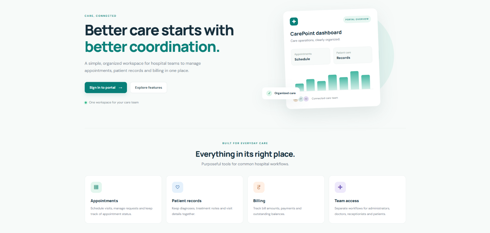
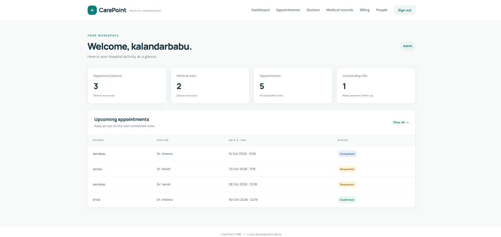
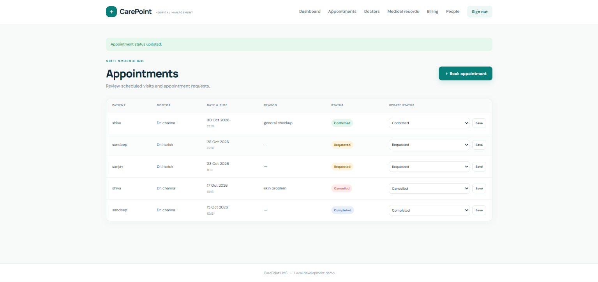
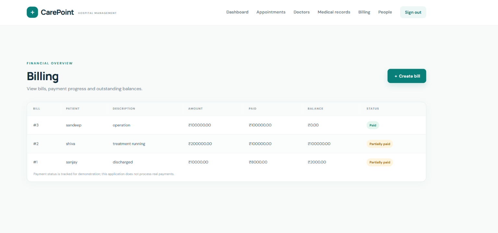
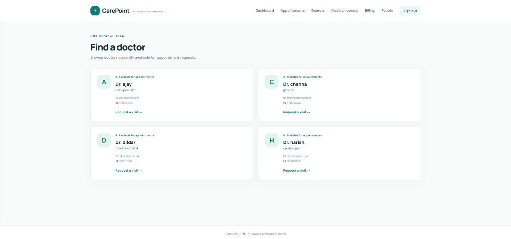

# CarePoint Hospital Management System

CarePoint HMS is a web-based hospital management application built with Python and Django. It demonstrates common hospital workflows through a simple interface for administrators, doctors, receptionists, and patients.

## Features

- **Role-based accounts:** Admin, Doctor, Receptionist, and Patient
- **Authentication:** Sign in and sign out
- **Account management:** Create and view hospital accounts
- **Doctor availability:** Manage doctor availability
- **Appointment management:** Book appointments, view schedules, and update status
- **Medical records:** Create and view patient medical records according to user permissions
- **Billing management:** Track bills, payment status, and outstanding balances
- **Responsive interface:** HTML, CSS, and JavaScript
- **Database:** SQLite for local development

## Technologies Used

- Python
- Django
- SQLite
- HTML5
- CSS3
- JavaScript
- Git and GitHub

## Screenshots

### Home Page


### Admin Dashboard


### Appointments Management


### Billing Management


### Doctor Directory


## Project Structure

```text
hospital_management_system/
├── config/          # Django project configuration
├── hospital/        # Hospital application
├── templates/       # HTML templates
├── static/          # CSS, JavaScript, and static assets
├── screenshots/     # Project screenshots
├── manage.py        # Django management commands
├── requirements.txt # Python dependencies
├── .gitignore       # Files excluded from Git
└── README.md        # Project documentation
```

*Adjust the folder names above if your actual project structure differs.*

## Requirements

- Python 3.10 or newer, compatible with the installed Django version
- pip
- Git (for version control)

## Installation and Setup

### 1. Clone the repository

```bash
git clone YOUR_GITHUB_REPOSITORY_URL
cd hospital_management_system
```

Alternatively, download the project and open its folder in VS Code.

### 2. Create and activate a virtual environment

On Windows PowerShell:

```powershell
python -m venv venv
.\venv\Scripts\Activate.ps1
```

On Windows Command Prompt:

```bat
python -m venv venv
venv\Scripts\activate.bat
```

### 3. Install dependencies

```bash
python -m pip install -r requirements.txt
```

### 4. Apply database migrations

```bash
python manage.py migrate
```

### 5. Create an administrator

```bash
python manage.py createsuperuser
```

Follow the prompts to create the administrator account.

### 6. Run the development server

```bash
python manage.py runserver
```

Open http://127.0.0.1:8000/ in your browser and sign in.

Use **People → Create account** to add doctor, receptionist, and patient accounts, subject to your application's permissions.

## Important Notes

- This is a learning and demonstration project, not a production medical record system.
- Do not enter real patient information.
- Billing tracks payment status; it does not process actual payments.
- Before public deployment, configure environment-based secrets, `DEBUG = False`, `ALLOWED_HOSTS`, HTTPS, backups, logging, and an appropriate production database. Conduct a security and privacy review.

## Future Improvements

- Automated tests for views, forms, permissions, and workflows
- Appointment search and filtering
- Email notifications for appointments
- Deployment with production security settings

## Author

**Kalandar Babu**

GitHub: [Add your GitHub profile URL here.](https://github.com/settings/profile)
